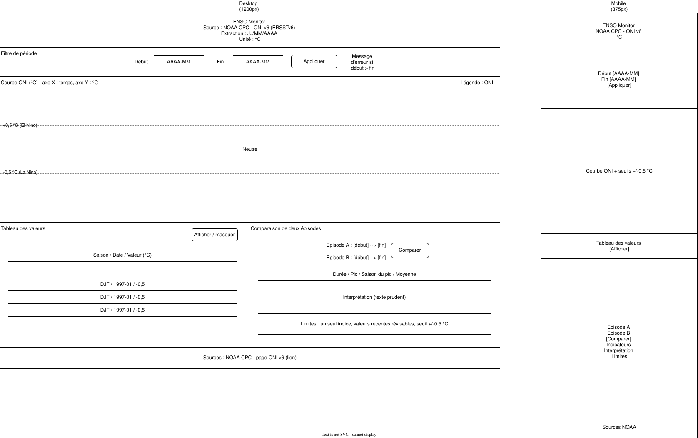

# ENSO Monitor

## Dossier de conception

Plateforme d'analyse des épisodes El Niño et La Niña à partir de l'indice ONI de la NOAA.

Victor Chabeau  
HETIC, Web3, sujet de rattrapage 2026

### Sommaire

1. Besoin et contexte
2. Fonctionnel et UX
3. UML et modélisation
4. Architecture technique
5. Organisation du projet
6. Qualité et sécurité
7. Déploiement proposé
8. Bilan et sources

# 1. Besoin et contexte

## Objectif

ENSO Monitor permet d'explorer l'indice ONI (Oceanic Niño Index) publié par la NOAA, de visualiser les épisodes El Niño et La Niña depuis 1950 et de comparer deux épisodes historiques. Les données sont réelles, sourcées et vérifiables : chaque valeur est rattachée à l'import qui l'a enregistrée et à une copie brute de la page NOAA.

## Public cible

- Le grand public, qui entend parler d'El Niño dans l'actualité et veut comprendre de quoi il s'agit.
- Les étudiants et enseignants en géographie ou en sciences de la Terre, qui ont besoin d'une visualisation simple et sourcée.
- Les journalistes, qui veulent comparer un épisode en cours à des épisodes passés.

## Contraintes

- Projet individuel réalisé en cinq jours.
- Stack imposée : React, TypeScript et Vite pour l'interface ; FastAPI pour l'API ; PostgreSQL, SQLAlchemy et Alembic pour les données ; Python, Pandas et NumPy pour l'ETL.
- Une série NOAA authentique (ONI ou RONI), avec sa source, sa version et sa date d'extraction.
- Une interface responsive, utilisable au clavier, avec des graphiques accessibles.
- Aucune dépense : le déploiement est documenté mais pas réalisé.

## Périmètre du MVP

1. Import de l'indice ONI v6 dans PostgreSQL, avec identification de la source et contrôle des doublons.
2. API FastAPI documentée, avec filtrage par période et validation des entrées.
3. Courbe interactive avec filtre de période, unité et source visibles, et un tableau en alternative.
4. Comparaison de deux épisodes historiques avec une interprétation prudente.

La détection automatique des épisodes est une extension, hors du MVP.

## Limites

- **Un seul indice.** L'ONI mesure la température de surface d'une zone du Pacifique (Niño 3.4). Il ne décrit ni la composante atmosphérique d'ENSO ni ses effets régionaux.
- **ONI et RONI.** Depuis le communiqué NWS 26-05, la NOAA utilise le RONI pour le suivi officiel. L'ONI reste l'indice de référence des études historiques, qui sont l'objet de l'application.
- **Valeurs récentes provisoires.** La NOAA peut réviser une valeur jusqu'à deux mois après sa publication.
- **Granularité saisonnière.** Chaque valeur est une moyenne sur trois mois glissants.
- **Pas de prévision.** L'application décrit des mesures passées.
- **Dépendance à la page NOAA.** Les données ne sont publiées que sous forme de tableau HTML, sans fichier brut ni API. Un changement de mise en page bloquerait l'import, sans toucher aux données déjà en base.

# 2. Fonctionnel et UX

## User stories et critères d'acceptation

L'application a deux acteurs : le **visiteur**, qui consulte les données, et l'**administrateur**, qui lance l'import NOAA en ligne de commande.

**US1, consulter la courbe ONI.** En tant que visiteur, je veux voir l'évolution de l'ONI sous forme de courbe, afin de repérer les épisodes El Niño et La Niña.
Critères : valeurs dans l'ordre chronologique ; unité, source, version et date d'extraction visibles ; seuils de ±0,5 °C tracés ; message pendant le chargement et en cas d'erreur de l'API.

**US2, filtrer par période.** En tant que visiteur, je veux choisir une date de début et une date de fin, afin d'observer une période précise.
Critères : seules les valeurs de la période sont affichées ; message d'erreur si le début suit la fin, sans modifier la courbe ; message si la période ne contient aucune donnée ; filtre utilisable au clavier.

**US3, comparer deux épisodes.** En tant que visiteur, je veux comparer deux épisodes passés, afin de voir ce qui les rapproche ou les distingue.
Critères : choix de deux périodes ; durée, pic, saison du pic et moyenne pour chacune ; texte d'interprétation prudent, sans prévision ni classe « Super El Niño » ; rappel des limites.

**US4, lire les valeurs en tableau.** En tant que visiteur utilisant un lecteur d'écran, je veux accéder aux valeurs sous forme de tableau, afin de ne pas dépendre du graphique.
Critères : mêmes valeurs que la courbe ; tableau synchronisé avec le filtre ; en-têtes de colonnes lisibles par un lecteur d'écran.

**US5, utiliser le site sur mobile et au clavier.** En tant que visiteur, je veux utiliser l'application quel que soit mon équipement.
Critères : lisible sur 375 px de large sans défilement horizontal ; chaque contrôle accessible avec Tab, avec un focus visible ; contrastes conformes au niveau AA des WCAG.

**US6, importer les données NOAA sans doublon.** En tant qu'administrateur, je veux lancer l'import de l'ONI, afin de disposer de données à jour, traçables et sans doublon.
Critères : copie brute datée et son empreinte SHA-256 ; aucune saison enregistrée deux fois ; valeurs révisées mises à jour ; import tracé avec ses compteurs et son statut ; relancer l'import sans changement côté NOAA n'insère rien.

**US7, voir les épisodes détectés (extension).** En tant que visiteur, je veux voir la liste des épisodes détectés, afin de choisir plus facilement ceux à comparer.
Critères : règle de la NOAA appliquée (±0,5 °C pendant au moins 5 saisons consécutives) et affichée à côté de la liste.

## Priorisation

J'ai classé les stories avec la méthode MoSCoW :

- **Must** : US1 à US6. Elles couvrent les quatre fonctionnalités du MVP et les exigences d'accessibilité.
- **Should** : aucune. Chaque besoin était soit indispensable au MVP, soit un simple confort.
- **Could** : US7. La comparaison fonctionne sans elle, puisque le visiteur peut choisir ses périodes à la main.
- **Won't** : prévisions climatiques, second indice (RONI), carte Copernicus ERA5, interface d'administration web, exports et statistiques avancées, classification « Super El Niño », déploiement réel. Ces exclusions sont justifiées dans les arbitrages de la section 5.

## Parcours utilisateurs

**Visiteur, parcours principal.**

1. À l'ouverture, la courbe couvre toute la période depuis 1950, avec la source et l'unité dans l'en-tête.
2. Le visiteur choisit une période et la valide avec « Appliquer » : la courbe et le tableau se mettent à jour.
3. Les lignes de seuil lui montrent quand l'indice dépasse +0,5 °C (El Niño) ou descend sous -0,5 °C (La Niña).
4. Dans la comparaison, deux épisodes El Niño sont proposés par défaut (1997-1998 et 2014-2016). Il peut les modifier, puis clique sur « Comparer » : les indicateurs, l'interprétation et les limites s'affichent.

En cas d'erreur, un message explique le problème sans effacer ce qui était affiché : début après la fin, période sans donnée, API injoignable, ou période de comparaison vide.

**Administrateur, import des données.** Il lance la commande d'import. L'ETL télécharge la page ONI v6, en garde une copie datée avec son empreinte, nettoie les valeurs, insère les nouvelles et met à jour celles que la NOAA a révisées, puis affiche le bilan. Si la NOAA est injoignable, l'import est enregistré en échec, et le site continue de fonctionner avec les données déjà en base.

## Wireframes

Sur ordinateur, l'en-tête regroupe le titre, la source, la version, la date d'extraction et l'unité. Le filtre est au-dessus d'une courbe pleine largeur, puis viennent le tableau et la comparaison. Sur mobile, les mêmes zones sont empilées dans le même ordre, et le tableau est replié par défaut pour ne pas allonger la page de plus de 900 lignes.

L'application suit ce découpage, avec une différence : sur ordinateur aussi, la comparaison est placée sous le tableau et non à côté, pour laisser assez de largeur aux deux formulaires d'épisode.

# 3. UML et modélisation

## Diagramme de cas d'utilisation

Diagramme : [docs/diagrams/use-cases.drawio.svg](diagrams/use-cases.drawio.svg)

Le système a trois acteurs. Le **visiteur** consulte la courbe, la filtre, lit le tableau des valeurs et compare deux épisodes. L'**administrateur** lance l'import des données. La **NOAA** est un acteur système : elle fournit la page source de l'import, sans faire partie de l'application.

Deux relations précisent les cas. Le filtrage **étend** (extend) la consultation de la courbe : on peut regarder la courbe sans filtrer. Le contrôle des doublons est **inclus** (include) dans l'import : chaque import le réalise obligatoirement.

L'administrateur n'a pas d'interface web : l'import se lance en ligne de commande. Une interface aurait demandé une authentification et agrandi la surface d'attaque, pour un seul utilisateur qui lance l'import une fois par mois.

## Diagramme de classes

Diagramme : [docs/diagrams/class-diagram.drawio.svg](diagrams/class-diagram.drawio.svg)

Le modèle reprend les quatre entités demandées :

- **Source** : l'organisme qui publie les données (NOAA CPC) et l'adresse de la page d'origine.
- **ClimateIndex** : la série suivie (ONI), avec son unité (°C) et la version du jeu de données (ERSSTv6).
- **ImportRun** : une exécution de l'ETL, avec sa date, le chemin de la copie brute, son empreinte SHA-256, le bilan chiffré et le statut.
- **Observation** : une valeur de l'indice pour une saison, datée par le mois central de la saison.

Justification des cardinalités :

- **Source 1 — 0..\* ClimateIndex.** Une source peut publier plusieurs indices : la NOAA publie l'ONI et le RONI. Ajouter le RONI ne demanderait qu'une ligne de plus, sans modifier la structure.
- **ClimateIndex 1 — 0..\* ImportRun.** L'import est relancé à chaque mise à jour de la NOAA, et chaque exécution concerne un seul indice.
- **ClimateIndex 1 — 0..\* Observation.** Une valeur n'a de sens que rattachée à son indice.
- **ImportRun 1 — 0..\* Observation.** Chaque valeur est rattachée à l'import qui l'a écrite ou révisée en dernier : c'est la traçabilité. Un import sans nouveauté n'écrit aucune valeur, d'où le minimum à 0.

# 4. Architecture technique

## Composants et flux de données

Diagramme : [docs/diagrams/architecture.drawio.svg](diagrams/architecture.drawio.svg)

L'application est découpée en quatre composants, chacun avec une seule responsabilité :

- **L'interface React** affiche la courbe, le filtre, le tableau et la comparaison. Elle n'appelle que l'API.
- **L'API FastAPI** valide les paramètres, lit la base, calcule les indicateurs de comparaison et renvoie du JSON. Elle ne fait que lire.
- **PostgreSQL** stocke les sources, les indices, les imports et les observations.
- **Le worker ETL** télécharge la page NOAA, en garde une copie brute, nettoie les valeurs et les écrit en base. C'est le seul composant qui écrit.

Les données circulent dans un seul sens : NOAA, ETL, PostgreSQL, API, puis navigateur. Le navigateur ne parle jamais directement à la base.

## Décisions d'architecture

### PostgreSQL pour les données

- **Besoin** : stocker les observations et leur provenance, en garantissant qu'aucune donnée incohérente n'entre en base.
- **Options** : des fichiers CSV, SQLite, PostgreSQL.
- **Choix** : PostgreSQL, imposé par le sujet et adapté au besoin.
- **Avantages** : les contraintes (unicité, plages de valeurs, clés étrangères) sont appliquées par la base elle-même ; l'API et l'ETL y accèdent en même temps sans conflit.
- **Limites** : un service de plus à faire tourner, alors que le volume reste faible (environ 920 lignes).
- **Vérification** : un second import n'insère aucune ligne, et la base contient 921 dates distinctes pour 921 observations.

### Un ETL séparé de l'API

- **Besoin** : importer les données une fois par mois sans perturber la consultation.
- **Options** : appeler la NOAA à chaque requête de l'API, lancer l'import au démarrage de l'API, ou en faire un programme à part.
- **Choix** : un worker séparé, lancé à la demande (`docker compose run --rm etl`).
- **Avantages** : une panne de la NOAA ne touche pas le site ; l'API reste en lecture seule ; chaque programme a un seul rôle.
- **Limites** : l'import est manuel, sans planification automatique.
- **Vérification** : chaque import est tracé avec son statut ; un import en échec est enregistré `failed` sans modifier les données déjà en base.

### Une API versionnée sous /api/v1

- **Besoin** : un contrat stable entre l'API et l'interface.
- **Options** : des routes sans préfixe, une version passée dans un en-tête HTTP, ou un préfixe dans l'adresse.
- **Choix** : le préfixe `/api/v1`, porté par un routeur FastAPI.
- **Avantages** : une évolution incompatible pourra être publiée sous `/api/v2` sans casser l'interface ; le reverse proxy peut router tout `/api/` vers FastAPI.
- **Limites** : maintenir plusieurs versions en parallèle aurait un coût, inutile tant qu'il n'y en a qu'une.
- **Vérification** : la documentation OpenAPI générée liste les quatre routes, et le test d'API appelle `/api/v1/observations`.

### Docker Compose pour l'exécution

- **Besoin** : lancer la base, l'API, l'ETL et l'interface de la même façon sur toutes les machines.
- **Options** : une installation manuelle, des conteneurs lancés un par un, Docker Compose, Kubernetes.
- **Choix** : Docker Compose, avec deux réseaux et un volume pour la base.
- **Avantages** : une commande suffit, les versions sont fixées, et la base n'est joignable que par l'API et l'ETL. Le même fichier sert de base au déploiement.
- **Limites** : tout tourne sur un seul serveur, sans redondance.
- **Vérification** : `docker compose up -d --build` lance l'application complète, et l'import fonctionne dans un conteneur.

### Un graphique accessible

- **Besoin** : rendre la courbe compréhensible par tous, y compris avec un lecteur d'écran ou une mauvaise perception des couleurs.
- **Options** : un graphique seul, une image fixe, ou un graphique accompagné d'une alternative textuelle.
- **Choix** : une courbe Recharts, des seuils signalés par un texte et pas seulement par une couleur, une légende descriptive, et un tableau qui suit le même filtre.
- **Avantages** : les mêmes données restent lisibles sans voir le graphique.
- **Limites** : le tableau complet est long (921 lignes), d'où son affichage replié par défaut ; Recharts alourdit le JavaScript livré (environ 600 Ko).
- **Vérification** : score d'accessibilité Lighthouse de 100/100, contrastes calculés, navigation complète au clavier.

### La traçabilité des données

- **Besoin** : pouvoir prouver d'où vient chaque valeur affichée.
- **Options** : importer sans trace, écrire un journal texte, ou enregistrer chaque import en base avec la copie brute.
- **Choix** : une table `import_run` et une copie brute datée de la page NOAA, avec son empreinte SHA-256.
- **Avantages** : chaque valeur remonte à son import, au fichier d'origine et à la source ; n'importe qui peut vérifier l'empreinte ; les tests tournent sur la copie, sans internet.
- **Limites** : une copie d'environ 160 Ko est conservée à chaque import, sans purge.
- **Vérification** : l'empreinte recalculée avec `shasum -a 256` est identique à celle enregistrée en base.

## Schéma relationnel

Notation : clé primaire en gras, `#` pour une clé étrangère.

- source (**id**, name, url)
- climate_index (**id**, #source_id, code, name, unit, dataset_version)
- import_run (**id**, #climate_index_id, started_at, finished_at, raw_file_path, sha256, rows_read, rows_inserted, rows_updated, rows_skipped, status)
- observation (**id**, #climate_index_id, #import_run_id, season, period_date, value)

**Intégrité.** Chaque clé étrangère suit une association du diagramme de classes. La contrainte `uq_observation_index_date` interdit deux valeurs pour le même indice à la même date. Trois contrôles refusent les données invalides : une valeur hors de -5 à +5 °C, une saison inconnue, ou un statut d'import autre que `running`, `success` ou `failed`. Le code d'un indice est unique, et seules les colonnes de fin d'import (`finished_at`, `raw_file_path`, `sha256`) peuvent rester vides tant que l'import n'a pas abouti.

**Index.** La contrainte d'unicité sur (climate_index_id, period_date) crée un index qui sert aussi la requête principale de l'API : les observations d'un indice sur une période. Pour ce volume, aucun autre index n'est nécessaire.

**Migrations.** Alembic crée le schéma à partir des modèles SQLAlchemy. Toute évolution future de structure passera par une nouvelle migration versionnée, réversible.

**Provenance.** Une observation renvoie à son import (date, copie brute, empreinte), qui renvoie à l'indice (ONI, °C, ERSSTv6), qui renvoie à la source (NOAA CPC et l'adresse de sa page).

# 5. Organisation du projet

## Backlog

Le backlog détaillé compte 33 tâches, de T01 à T33, chacune reliée à une user story, avec une priorité, une estimation et un statut (`docs/conception/organisation.md`). Regroupées par étape :

- **Conception** (T01 à T07) : user stories, parcours, diagrammes, wireframes, backlog et risques.
- **Base de données et ETL** (T08 à T13) : PostgreSQL dans Docker, modèles et migration, extraction, transformation, chargement et test des données.
- **API** (T14 à T19) : application FastAPI, routes et validation, comparaison, CORS, test de l'API et diagramme de séquence.
- **Interface** (T21 à T27) : projet Vite, client API, hook de chargement, composants, comparaison, accessibilité et test de l'interface.
- **Livraison** (T28 à T33) : Docker Compose, qualité du code, correction d'une anomalie, README, dossier et préparation de l'oral.

Toutes les tâches sont réalisées, sauf T20, la détection automatique des épisodes, classée Could et abandonnée comme prévu.

## Planning sur cinq jours

- **Jour 1** : installation, conception complète et lancement de la base de données.
- **Jour 2** : modèles, migration, ETL complet et test des données.
- **Jour 3** : API, validation des entrées, comparaison, CORS, test de l'API et diagramme de séquence.
- **Jour 4** : interface, comparaison, vérifications d'accessibilité et test de l'interface.
- **Jour 5** : Docker Compose, qualité, correction d'anomalie, README et dossier.

L'ordre suit les dépendances : l'API a besoin de données réelles, et l'interface a besoin de routes qui fonctionnent. Le travail a été mené en sessions réparties sur plusieurs semaines, mais dans cet ordre et selon ce découpage.

## Arbitrages

- **La comparaison de périodes choisies avant la détection automatique.** La comparaison suffit au MVP ; la détection était une extension, abandonnée en premier quand le temps a manqué.
- **L'ONI plutôt que le RONI.** C'est l'indice de référence des études historiques, et le RONI pourrait être ajouté sans changer le modèle.
- **L'import en ligne de commande plutôt qu'une interface d'administration.** Un seul administrateur, et pas d'authentification à sécuriser.
- **oxlint plutôt qu'ESLint**, contrairement au plan initial. Le modèle Vite actuel installe TypeScript 7, que le module TypeScript d'ESLint ne prend pas encore en charge. oxlint, fourni par Vite, joue le même rôle sans configuration.
- **L'API et l'interface lancées hors Docker pendant le développement**, pour profiter du rechargement instantané. Docker Compose sert à la démonstration complète.
- **La copie brute de la page NOAA conservée dans le dépôt** : environ 160 Ko par import, en échange de la traçabilité et de tests qui fonctionnent hors ligne.

## Risques

- **La NOAA modifie sa page ou la rend inaccessible.** Parade : copie brute datée, tests sur cette copie, import en échec tracé sans toucher aux données en base.
- **La NOAA révise des valeurs récentes**, ce qui est certain. Parade : l'import met à jour la valeur au lieu de créer un doublon, et la compte dans le bilan.
- **Docker Desktop ne peut plus être mis à jour sur mon Mac (macOS 12).** Parade : la version installée suffit au projet. Un plantage au redémarrage de Docker s'est produit, réglé en attendant l'arrêt complet avant de relancer.
- **Plusieurs outils découverts en même temps** (SQLAlchemy, Alembic, FastAPI, Recharts). Parade : avancer par petites étapes, avec un commit à chaque étape qui fonctionne.
- **Un dépassement de temps sur l'interface**, la journée la plus chargée. Parade : abandon de l'extension, ce qui s'est produit.
- **Une interprétation scientifique abusive.** Parade : texte généré uniquement à partir des mesures, sans prévision ni « Super El Niño », avec un encadré des limites.
- **La fuite d'un secret.** Parade : fichier `.env` ignoré par Git, et modèle `.env.example` sans mot de passe.

## Outils et suivi

Outils : VS Code, Git et GitHub, draw.io, Docker Desktop, et Claude Code comme assistant (voir la section 8).

Le suivi s'appuie sur les statuts du backlog, mis à jour au fil du projet, et sur l'historique Git : 44 commits sur 14 journées de travail, du 28 octobre au 19 novembre 2026, au format Conventional Commits (`feat`, `fix`, `test`, `docs`, `style`, `chore`). Chaque étape qui fonctionne a donné lieu à au moins un commit, et chaque test exigé a sa capture dans `docs/screenshots/`.
