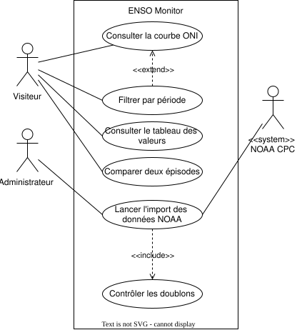
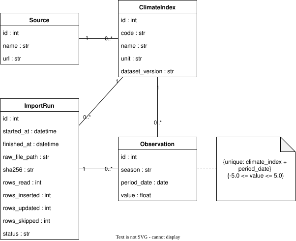
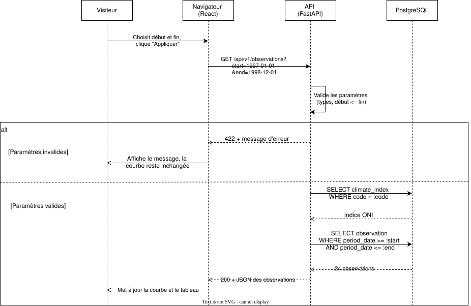
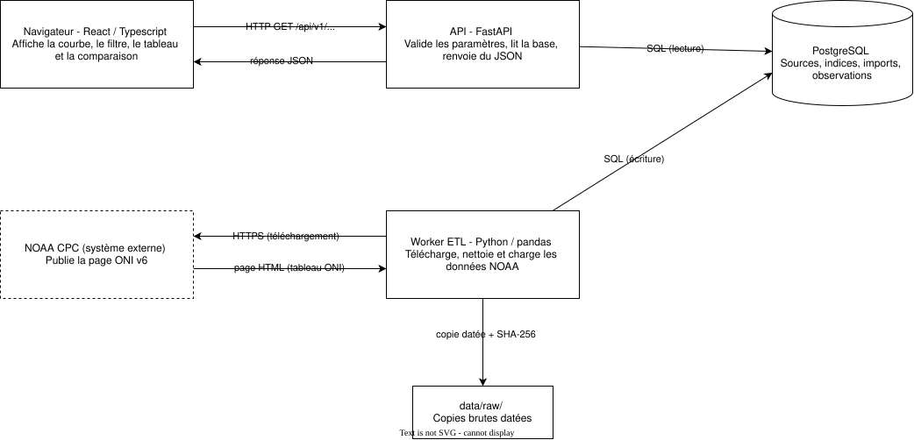

# ENSO Monitor

## Dossier de conception

Plateforme d'analyse des épisodes El Niño et La Niña à partir de l'indice ONI de la NOAA.

Victor Chabeau  
HETIC, Web3, sujet de rattrapage 2026

### Sommaire

1. Besoin et contexte
2. Fonctionnel et UX
3. UML et modélisation
4. Architecture technique
5. Organisation du projet
6. Qualité et sécurité
7. Déploiement proposé
8. Bilan et sources

<div style="page-break-after: always;"></div>

# 1. Besoin et contexte

ENSO Monitor permet d'explorer l'indice ONI (Oceanic Niño Index) de la NOAA depuis 1950, de repérer les épisodes El Niño et La Niña et d'en comparer deux. Chaque valeur affichée est réelle et vérifiable : elle est rattachée à l'import qui l'a enregistrée et à une copie brute de la page NOAA.

**Public cible** : le grand public qui entend parler d'El Niño dans l'actualité, les étudiants et enseignants en sciences de la Terre, les journalistes qui comparent un épisode en cours à des épisodes passés.

**Contraintes** : projet individuel en cinq jours ; stack imposée (React, TypeScript, Vite, FastAPI, PostgreSQL, SQLAlchemy, Alembic, Pandas, NumPy) ; une série NOAA authentique, sourcée et datée ; interface responsive et accessible ; aucune dépense.

**Périmètre du MVP** :

1. import de l'ONI v6 dans PostgreSQL, avec identification de la source et contrôle des doublons ;
2. API FastAPI documentée, avec filtrage par période et validation des entrées ;
3. courbe interactive filtrable, avec unité et source visibles, et un tableau en alternative ;
4. comparaison de deux épisodes avec une interprétation prudente.

**Limites** :

- l'ONI ne mesure que la température de surface de la zone Niño 3.4, pas la composante atmosphérique ni les effets régionaux d'ENSO ;
- la NOAA utilise désormais le RONI pour le suivi officiel (communiqué NWS 26-05) ; l'ONI reste la référence des études historiques, objet de l'application ;
- les valeurs récentes peuvent être révisées pendant deux mois, et chaque valeur est une moyenne sur trois mois ;
- l'application décrit le passé et ne fait aucune prévision ;
- la NOAA ne publie qu'un tableau HTML : un changement de sa mise en page bloquerait l'import, sans toucher aux données déjà en base.

# 2. Fonctionnel et UX

## User stories et critères d'acceptation

Deux acteurs : le visiteur, qui consulte, et l'administrateur, qui lance l'import en ligne de commande.

- **US1, consulter la courbe ONI**, pour repérer les épisodes. Critères : ordre chronologique ; unité, source, version et date d'extraction visibles ; seuils de ±0,5 °C ; états de chargement et d'erreur.
- **US2, filtrer par période**. Critères : seules les valeurs de la période s'affichent ; erreur si le début suit la fin, sans toucher à la courbe ; message si aucune donnée ; utilisable au clavier.
- **US3, comparer deux épisodes**. Critères : durée, pic, saison du pic et moyenne ; interprétation prudente, sans prévision ni « Super El Niño » ; rappel des limites.
- **US4, lire les valeurs en tableau**, pour un visiteur avec lecteur d'écran. Critères : mêmes valeurs que la courbe, synchronisées avec le filtre ; en-têtes de colonnes.
- **US5, utiliser le site sur mobile et au clavier**. Critères : lisible sur 375 px ; focus visible ; contrastes WCAG AA.
- **US6, importer les données sans doublon** (administrateur). Critères : copie brute datée avec empreinte SHA-256 ; aucune saison en double ; valeurs révisées mises à jour ; import tracé ; relancer l'import sans nouveauté n'insère rien.
- **US7, voir les épisodes détectés** (extension). Critère : règle NOAA de 5 saisons consécutives au-delà de ±0,5 °C.

**Priorisation MoSCoW** : US1 à US6 en Must, car elles couvrent le MVP et l'accessibilité ; US7 en Could, la comparaison fonctionnant avec des périodes choisies ; en Won't, les prévisions, le RONI, la carte ERA5, une interface d'administration, les exports et le déploiement réel.

## Parcours utilisateurs

1. À l'ouverture, la courbe couvre toute la période depuis 1950, avec la source et l'unité dans l'en-tête.
2. Le visiteur choisit une période et clique sur « Appliquer » : la courbe et le tableau se mettent à jour.
3. Les lignes de seuil montrent les passages au-dessus de +0,5 °C (El Niño) et sous -0,5 °C (La Niña).
4. La comparaison propose deux El Niño par défaut (1997-1998 et 2014-2016), modifiables ; « Comparer » affiche les indicateurs, l'interprétation et les limites.

En cas d'erreur (dates incohérentes, période vide, API injoignable), un message s'affiche et la courbe précédente reste visible. Côté administrateur, l'import télécharge la page, garde sa copie, met à jour la base et affiche son bilan ; si la NOAA est injoignable, l'import est enregistré en échec et le site continue de fonctionner.

## Wireframes


En-tête avec la source, filtre, courbe pleine largeur, puis tableau et comparaison ; sur mobile, les zones sont empilées et le tableau est replié. Dans l'application, la comparaison est placée sous le tableau, y compris sur ordinateur, pour laisser de la largeur aux deux formulaires.

# 3. UML et modélisation

## Cas d'utilisation



La NOAA est un acteur système : elle fournit les données sans faire partie de l'application. Le filtre étend la consultation de la courbe (il est facultatif), et le contrôle des doublons est inclus dans l'import (il est systématique). L'administrateur n'a pas d'interface web, ce qui évite une authentification pour un seul utilisateur.

## Classes



- **Source 1 — 0..\* ClimateIndex** : la NOAA publie plusieurs indices ; ajouter le RONI ne demande qu'une ligne.
- **ClimateIndex 1 — 0..\* ImportRun** : un import concerne un indice, et il est relancé à chaque publication.
- **ClimateIndex 1 — 0..\* Observation** : une valeur n'a de sens que rattachée à son indice.
- **ImportRun 1 — 0..\* Observation** : chaque valeur est rattachée à l'import qui l'a écrite ou révisée en dernier ; un import sans nouveauté n'écrit rien.

La base impose l'unicité du couple (indice, date) et une plage de -5 à +5 °C. L'année n'est pas stockée, elle se déduit de la date.

## Séquence



Le visiteur filtre la courbe sur 1997-1998. L'API valide les dates avant toute requête : une entrée invalide renvoie 422 sans solliciter la base. Sinon, deux requêtes paramétrées (l'indice, puis les observations triées) donnent une réponse 200 en JSON. Un indice inconnu, non représenté, renvoie 404.

# 4. Architecture technique



L'interface React n'appelle que l'API. L'API FastAPI valide, lit la base, calcule la comparaison et renvoie du JSON ; elle ne fait que lire. Le worker ETL est le seul à écrire en base. Les données vont dans un seul sens : NOAA, ETL, PostgreSQL, API, navigateur.

## Décisions d'architecture

**PostgreSQL.** Besoin : stocker les observations et leur provenance sans incohérence. Options : CSV, SQLite, PostgreSQL. Choix : PostgreSQL. Avantages : contraintes appliquées par la base, accès simultané de l'API et de l'ETL. Limite : un service de plus pour environ 920 lignes. Vérification : un second import n'insère rien, 921 dates distinctes pour 921 valeurs.

**ETL séparé.** Besoin : importer chaque mois sans gêner la consultation. Options : appeler la NOAA à chaque requête, importer au démarrage de l'API, ou un programme à part. Choix : un worker lancé à la demande. Avantages : une panne de la NOAA ne touche pas le site, l'API reste en lecture seule. Limite : import manuel. Vérification : chaque import est tracé, un échec est enregistré sans modifier les données.

**API versionnée.** Besoin : un contrat stable avec l'interface. Options : sans préfixe, version dans un en-tête, préfixe d'URL. Choix : `/api/v1`. Avantages : une version incompatible pourra coexister en `/api/v2`, et le proxy route tout `/api/`. Limite : maintenir deux versions aurait un coût. Vérification : documentation OpenAPI générée, test d'API sur `/api/v1/observations`.

**Docker Compose.** Besoin : lancer les quatre composants de façon reproductible. Options : installation manuelle, conteneurs un par un, Compose, Kubernetes. Choix : Compose, avec deux réseaux et un volume. Avantages : une commande, versions fixées, base joignable seulement par l'API et l'ETL. Limite : un seul serveur. Vérification : `docker compose up -d --build` lance l'application, l'import tourne dans un conteneur.

**Graphique accessible.** Besoin : une courbe lisible par tous. Options : graphique seul, image, graphique avec alternative. Choix : Recharts, seuils signalés par un texte, légende descriptive et tableau synchronisé. Avantage : les données restent lisibles sans le graphique. Limites : tableau long, replié par défaut ; Recharts alourdit le JavaScript. Vérification : Lighthouse 100/100 en accessibilité, contrastes calculés.

**Traçabilité.** Besoin : prouver l'origine de chaque valeur. Options : aucun suivi, journal texte, imports tracés en base. Choix : table `import_run`, copie brute datée et empreinte SHA-256. Avantages : chaque valeur remonte au fichier et à la source ; les tests tournent sur la copie, hors ligne. Limite : une copie d'environ 160 Ko par import. Vérification : l'empreinte recalculée avec `shasum -a 256` est identique à celle en base.

## Schéma relationnel

Clé primaire en gras, `#` pour une clé étrangère :

- source (**id**, name, url)
- climate_index (**id**, #source_id, code, name, unit, dataset_version)
- import_run (**id**, #climate_index_id, started_at, finished_at, raw_file_path, sha256, rows_read, rows_inserted, rows_updated, rows_skipped, status)
- observation (**id**, #climate_index_id, #import_run_id, season, period_date, value)

Contraintes : unicité (climate_index_id, period_date), valeur entre -5 et +5, saison parmi les 12 de la NOAA, statut d'import contrôlé, code d'indice unique. L'index créé par la contrainte d'unicité sert aussi le filtrage par période. Le schéma est créé et versionné par les migrations Alembic.

# 5. Organisation du projet

Le backlog compte 33 tâches (T01 à T33), reliées aux user stories, avec priorité, estimation et statut (`docs/conception/organisation.md`). Toutes sont réalisées, sauf T20, la détection automatique des épisodes, abandonnée comme prévu.

**Planning sur cinq jours** : jour 1, conception et base de données ; jour 2, ETL et test des données ; jour 3, API et test de l'API ; jour 4, interface, accessibilité et test de l'interface ; jour 5, Docker, qualité, README et dossier. L'ordre suit les dépendances : pas d'API sans données, pas d'interface sans API. Le travail a été mené en sessions sur plusieurs semaines, dans cet ordre.

**Arbitrages** :

- la comparaison de périodes choisies avant la détection automatique, abandonnée en premier ;
- l'ONI plutôt que le RONI, pour l'étude historique ;
- l'import en ligne de commande plutôt qu'une interface d'administration ;
- oxlint au lieu d'ESLint : Vite installe TypeScript 7, que le module TypeScript d'ESLint ne gère pas encore.

**Risques et parades** :

- page NOAA modifiée ou injoignable : copie brute, tests hors ligne, import en échec tracé ;
- révisions des valeurs récentes : mise à jour au lieu d'un doublon ;
- Docker Desktop bloqué sur macOS 12 : la version installée suffit ; un plantage au redémarrage a été réglé ;
- dépassement de temps sur l'interface : abandon de l'extension, ce qui s'est produit ;
- fuite d'un secret : `.env` ignoré par Git.

**Suivi** : statuts du backlog et historique Git, plus de 40 commits au format Conventional Commits, chaque étape fonctionnelle donnant lieu à un commit. Outils : VS Code, Git, draw.io, Docker Desktop, Claude Code.

# 6. Qualité et sécurité

## Tests

Sept tests, tous reproductibles sans internet ni vraie base :

- **données** : un doublon, une saison invalide et une case vide sont rejetés ; la copie NOAA donne 921 valeurs ;
- **API** : sur une base SQLite injectée à la place de PostgreSQL, le filtre 1997-1998 renvoie les bonnes valeurs, et un début après la fin un 422 ;
- **interface** : avec un client API simulé, changer la période met à jour le nombre de valeurs et le tableau ;
- **non-régression** : deux tests écrits pour reproduire une anomalie avant de la corriger.

Les captures sont dans `docs/screenshots/`, et le code passe Ruff et oxlint sans erreur. Limites : pas de test dans un vrai navigateur, ni de la courbe elle-même.

**Vérifications UX** : contrastes WCAG AA calculés (5,7:1 au minimum), navigation complète au clavier, affichage vérifié sur 375 px, structure lisible par les lecteurs d'écran, Lighthouse 100/100.

## Sécurité

- les secrets sont dans `.env`, ignoré par Git ;
- toutes les requêtes passent par SQLAlchemy, qui les paramètre : aucune n'est construite avec une entrée utilisateur ;
- les entrées sont validées par Pydantic et par la règle « début avant la fin », côté API ;
- l'API ne fait que lire, en GET ; CORS n'autorise que l'interface ; seuls les champs des schémas sortent ;
- la base n'est joignable que par l'API et l'ETL, et seul Caddy est exposé ;
- sans interface d'administration, il n'y a aucun compte à protéger ;
- les versions des dépendances sont figées.

## Performance

921 lignes, une ou deux requêtes par appel, servies par l'index d'unicité. L'ETL lit les valeurs existantes en une seule requête. L'interface n'appelle l'API qu'au clic et ignore les réponses devenues inutiles. Le JavaScript pèse 182 Ko compressé, surtout à cause de Recharts : le charger séparément serait la prochaine optimisation.

## Anomalies corrigées

- **Période mixte** : sur 1997-1998, le texte ne citait qu'El Niño alors que l'ONI descend à -1,5 °C. L'API renvoie désormais le minimum et le maximum, et chaque seuil est testé séparément. Deux tests, en échec avant la correction, passent après.
- **Contraste** : les textes de seuil de Recharts étaient trop pâles (3,9:1) ; leur couleur a été corrigée (8,9:1).
- **Mobile** : la courbe débordait après un redimensionnement ; son conteneur l'en empêche désormais.

# 7. Déploiement proposé

Le déploiement n'est pas réalisé, comme le permet le sujet.

**Hébergement** : un VPS Hetzner CX22 (2 processeurs, 4 Go de mémoire, 40 Go de disque) sous Debian 12, en Europe. PostgreSQL, l'API et Caddy occupent moins de 400 Mo, l'import environ 300 Mo pendant quelques secondes : 4 Go laissent une large marge.

**Conteneurs** : le `compose.yaml` local sert de base. En production, la base ne publie plus de port, Caddy publie 80 et 443 et garde ses certificats dans un volume, chaque service redémarre seul, et `CORS_ORIGINS` prend l'adresse publique.

```yaml
  frontend:
    build: ./frontend
    ports: ["80:80", "443:443"]
    volumes: ["caddy_data:/data"]
    restart: unless-stopped
```

**Caddy** est le seul point d'entrée : il sert l'interface, relaie `/api/` vers FastAPI, et obtient et renouvelle seul le certificat HTTPS, avec redirection depuis HTTP.

```
enso-monitor.example.org {
	encode gzip
	handle /api/* {
		reverse_proxy api:8000
	}
	handle {
		root * /srv
		file_server
	}
}
```

**Configuration** : `.env` créé sur le serveur et lisible par un seul utilisateur ; SSH par clé uniquement, sans connexion root ; pare-feu `ufw` n'ouvrant que 22, 80 et 443 ; correctifs Debian automatiques ; import mensuel par une tâche cron le 6 de chaque mois.

**Mise à jour** : sauvegarder la base, `git pull` ou passer sur une version étiquetée, `docker compose up -d --build` (les migrations s'appliquent au démarrage de l'API), puis vérifier `/api/v1/health`.

**Exploitation** :

- **sauvegardes** : `pg_dump` quotidien compressé, conservé 14 jours et copié hors du serveur ;
- **restauration** : le fichier est rejoué dans une base vide avec `psql`, et testé régulièrement en local ;
- **journaux** : `docker compose logs`, avec rotation ; les imports sont tracés en base ;
- **supervision** : un service extérieur interroge `/api/v1/health` chaque minute et alerte en cas d'échec ;
- **retour arrière** : revenir à l'étiquette Git précédente, et si besoin `alembic downgrade` ou la sauvegarde de la veille.

**Pannes** : NOAA injoignable, l'import échoue sans toucher au site ; API arrêtée, alerte puis redémarrage automatique ; base corrompue, restauration puis nouvel import ; serveur perdu, nouveau VPS et restauration en une heure environ.

**Limites** : un seul serveur est un point unique de panne, acceptable pour un site de consultation à faible trafic. Pistes : un VPS plus puissant, un cache des réponses de l'API (les données ne changent qu'une fois par mois), le chargement séparé de la courbe.

# 8. Bilan et sources

Le MVP est complet : import traçable sans doublon, API documentée, courbe filtrable et accessible, comparaison prudente. Les trois tests exigés passent, avec deux tests de non-régression, et l'application se lance avec Docker Compose. Seule l'extension de détection des épisodes manque. Le modèle de données, conçu avant le code, n'a pas eu à changer.

**Apports de l'IA** (Claude, via Claude Code) : un plan découpé en étapes vérifiées une à une, des propositions de code que j'ai saisies, relues, exécutées et vérifiées, une aide à la rédaction et une relecture.

**Ses limites** : le plan initial prévoyait ESLint, devenu incompatible ; certaines propositions étaient imparfaites (un avertissement du linter dans le hook, des textes de seuil mal placés), repérées par les contrôles et la vérification visuelle ; il fallait parfois faire préciser des consignes. Je n'ai gardé que ce que je savais justifier.

**Difficultés** : la page NOAA contient onze tableaux HTML, dont l'en-tête utile est répété tous les dix ans, d'où une détection du bon tableau par sa première ligne ; Docker Desktop ne peut plus être mis à jour sur macOS 12 ; quelques erreurs de manipulation, réglées en lisant les messages d'erreur jusqu'au bout. Avec plus de temps : détection des épisodes, RONI, test dans un navigateur, import planifié.

**Sources** :

- NOAA CPC, Oceanic Niño Index v6 : https://www.cpc.ncep.noaa.gov/products/analysis_monitoring/enso/oni/v6/index.php
- NOAA CPC, Relative Oceanic Niño Index : https://www.cpc.ncep.noaa.gov/products/analysis_monitoring/enso/roni/
- National Weather Service, communiqué 26-05 : https://www.weather.gov/media/notification/pdf_2026/pns26-05_Relative_ONI.pdf
- France compétences, RNCP 36146 ; W3C, WCAG 2.1 ; documentations de FastAPI, SQLAlchemy, Alembic, React, Vite, Recharts, Docker Compose et Caddy.
